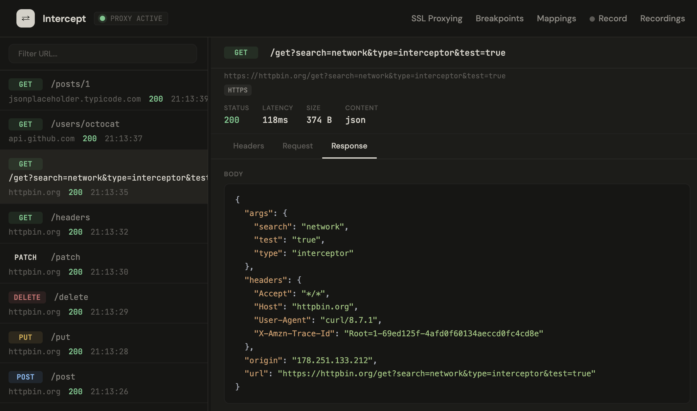

# Network Interceptor

An HTTP/HTTPS intercepting proxy with a web UI for inspecting and manipulating network traffic. Supports breakpoints to pause and respond to requests, response mapping to serve local files, and real-time traffic logging.



## Getting started

```bash
npm install
npm start
```

- Web UI: http://localhost:3000
- Proxy: localhost:8888

### Install the CA certificate

HTTPS interception requires trusting the generated CA certificate.

1. Open http://localhost:3000 and click **Download CA Cert**
2. Install and trust the certificate for your OS:

**macOS** — double-click the `.pem` file, open Keychain Access, find "Network Interceptor CA", double-click and set to "Always Trust"

**Windows** — double-click the `.pem` file, click "Install Certificate", select "Local Machine", place in "Trusted Root Certification Authorities"

**Linux**
```bash
sudo cp network-interceptor-ca.pem /usr/local/share/ca-certificates/network-interceptor.crt
sudo update-ca-certificates
```

### Configure your proxy

Point your browser or system proxy to `localhost:8888` for both HTTP and HTTPS.

**macOS:** System Preferences → Network → Advanced → Proxies

**Windows:** Settings → Network & Internet → Proxy → Manual proxy setup

**Firefox:** Settings → Network Settings → Manual proxy configuration

## Usage

**Traffic log** — all requests appear in the sidebar; click any entry to inspect headers and body.

**Breakpoints** — click "Breakpoints", add a URL pattern (e.g. `*api.example.com*`). Matching requests pause and let you continue normally or return a custom response.

**Response mapping** — click "Mappings", add a URL pattern and an absolute path to a local file. Matching requests are served that file's contents.

**Filter** — use the filter input to search captured traffic by URL.

URL patterns support `*` as a wildcard: `*api*`, `*.json`, `/api/users`.

## License

MIT
